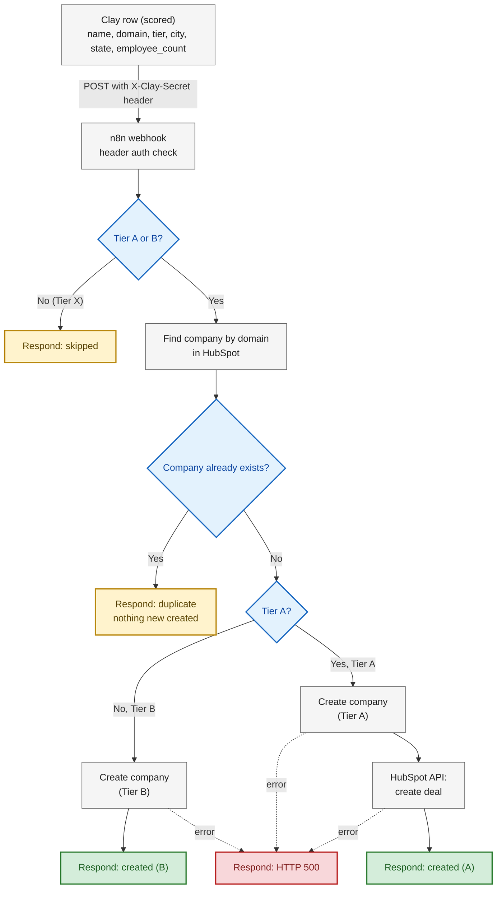

# Pump GTM: Load Scored Accounts into HubSpot

This project does one job: take a scored Clay company export and load the accounts into HubSpot through an n8n webhook. Tier A accounts get a company and a deal. Tier B accounts get a company only. Tier X accounts are never sent.

Scoring and tiering happen before the load, in `score_accounts.py`. Outreach, sequencing, research, and outcome measurement are out of scope.

## Flow



## What is in this repo

| Path | What it is |
| --- | --- |
| `data/raw/` | Clay exports, dated, never edited |
| `data/scored/` | Scorer output, regenerated on each run |
| `score_accounts.py` | Keyword scoring, tiering, manual overrides, domain dedupe |
| `n8n/clay_to_hubspot_workflow.json` | n8n workflow: webhook, duplicate check, HubSpot company and deal writes |

## Quick start

1. Score the export:

   ```bash
   python3 score_accounts.py data/raw/clay_fintech_export.csv data/scored/scored_accounts.csv
   ```

   Requires Python 3.8 or later. No external packages.

2. Import `n8n/clay_to_hubspot_workflow.json` into n8n.
3. Set the HubSpot credential on the three HubSpot nodes.
4. Set the header-auth secret on the webhook. Use the same value in Clay.
5. Activate the workflow.

## Scoring and tiers

Each company description is scanned for keywords. ICP signals (payments, lending, embedded finance, checkout, receivables, B2B, fintech) add points. Out-of-ICP signals (crypto, blockchain, insurance, wealth advisory, broker-dealers, trading, banks, tax preparation, social networks) subtract points.

| Tier | Score | Sent to HubSpot |
| --- | --- | --- |
| A | 4 or higher | Company and deal |
| B | 2 to 3 | Company only |
| X | below 2 | No |

Manual overrides live in `MANUAL_OVERRIDES` in `score_accounts.py`. Each override needs a reason, and the reason appears in the output file.

## Sending rows from Clay

Create a Clay table with a "Send to webhook" action that posts each row to `/clay-scored-account`. The body must include `name`, `domain`, `tier`, `city`, `state`, and `employee_count`. Send only Tier A and B rows. Tier X rows should not reach HubSpot.

If the Clay send fails, you can send one account from the terminal. Set the secret for your session, without writing it to a file:

```bash
export CLAY_SECRET="your-secret-here"
```

```bash
curl -s -X POST "https://saee-works-2026.app.n8n.cloud/webhook/clay-scored-account" -H "Content-Type: application/json" -H "X-Clay-Secret: $CLAY_SECRET" -d '{"name":"BillGO","domain":"billgo.com","city":"Fort Collins","state":"Colorado","employee_count":"","tier":"A"}'
```

Expected responses: `created` for a new account, `duplicate` for one already in HubSpot (nothing is created), and `skipped` for Tier X. Log each manual send.

## Next steps

1. Replace the deal stage placeholder with your pipeline's stage ID.
2. Run the workflow on one Tier A, one Tier B, and one Tier X row, and confirm the HubSpot results.
3. Load 5 Tier A accounts, then check HubSpot before loading the rest.
